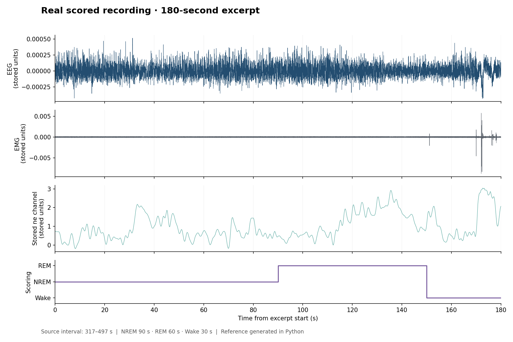

# Real scored recording: EEG, EMG and photometry visualisation

A three-minute real recording excerpt with 90 seconds of NREM, 60 seconds of REM, and 30 seconds of Wake. Use it to explore the data layout and plot signals alongside sleep scoring.

## Run

1. Download and extract the repository, or use a local clone.
2. Open `examples/scored_recording/run_example.m` in MATLAB and press **Run**.
3. Inspect the four-panel figure and the state-duration table. Results are also saved to `generated_output/` beside the script.

Requires base MATLAB with `table` and script execution support; no external data loader or toolbox is needed by this script. MATLAB execution has not yet been recorded.

To zoom, change `plot_window_s = [0 180]`, for example to `[80 160]`. The summary always describes the entire excerpt.

## What to expect

| State | Code | Duration | Percent of excerpt |
|---|---|---|---|
| Wake | 0 | 30 s | 16.6667% |
| NREM | 1 | 90 s | 50% |
| REM | 2 | 60 s | 33.3333% |

The PNG and CSV in `expected_output/` were generated independently in Python from the same excerpt. MATLAB styling may differ. The example includes assertions for scoring duration and state totals; it does not validate the original scoring or scientific methods.

## Data and timing

See [the variable guide](sample_data/README.md) and [the extraction manifest](sample_data/source_manifest.json). All times in the plots start at the excerpt boundary. Fractional first-sample offsets preserve each channel's original sampling grid.

The state labels were confirmed by the uploader. The one-second epoch duration is inferred from the source array lengths. EMG is assumed to use the EEG sampling rate. The source file does not establish TTL synchronisation.

EEG, EMG and the `ne` channel retain their stored values and native sampling rates. Physical signal units and previous processing are unspecified. In particular, `ne` is not relabelled as a particular neurotransmitter or as delta-F/F.

## Using this data elsewhere

- **Trace plotting:** use the included script directly.
- **Spindle detection:** an NREM mask must be constructed at the detector's target sampling rate. This example does not supply validated spindle events.
- **PAC:** do not treat this short excerpt as a validated PAC reference. Bout duration, filtering and boundary handling require an analysis-specific choice.
- **Photometry QC:** raw 405/465 channels are absent, so this dataset cannot demonstrate reference fitting in the photometry QC toolbox.

## Source

Provided by the repository contributor from `20251011-baseline-mouse3_scored.mat`. The excerpt covers stored-file seconds 317 up to, but not including, 497. It is the earliest 180-second window containing at least 30 scored seconds in each state, chosen to show state diversity.

Only cropping, row-to-column reshaping, and compact integer storage of the unchanged scoring labels were applied. Source and excerpt checksums and sample indices are recorded in the manifest. Data creator, acquisition details, calibration and data reuse terms remain unspecified; the source filename alone does not establish those details.
